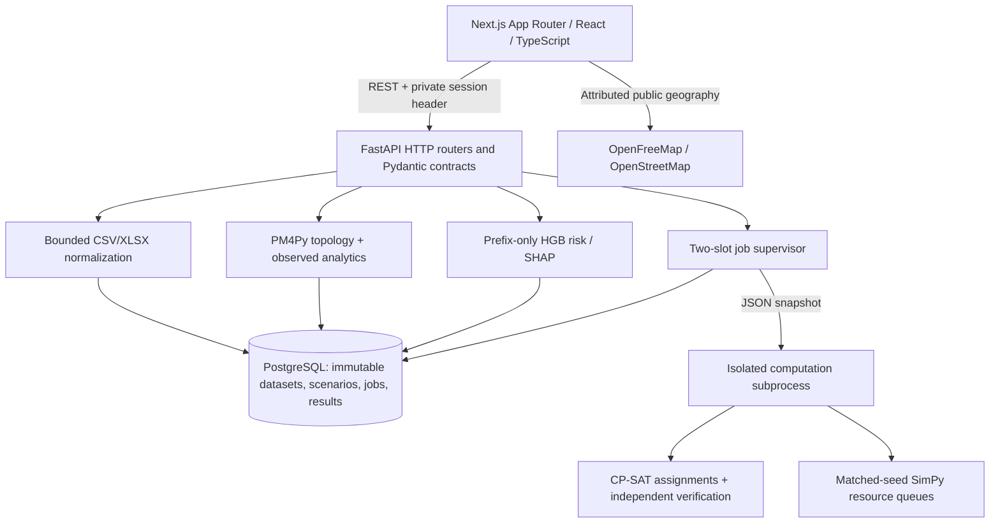
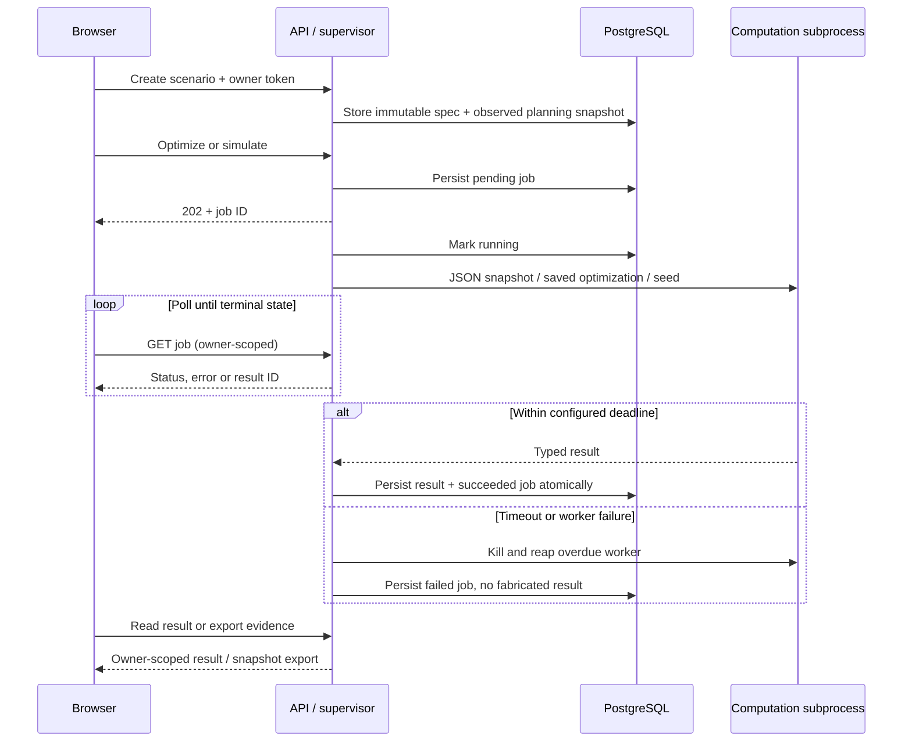

# BerthIQ architecture

This document describes the implemented launch application. Product semantics,
contracts and persistence are specified in [PRODUCT_DEFINITION.md](PRODUCT_DEFINITION.md),
[DATA_CONTRACTS.md](DATA_CONTRACTS.md) and [DATABASE.md](DATABASE.md). Current checks
and remaining blockers are recorded in [CODEX_LAUNCH_SPRINT.md](CODEX_LAUNCH_SPRINT.md).

## Runtime boundaries

One persistent FastAPI process owns the bounded computation slots and restart
recovery. There is no external queue or runtime LLM. PostgreSQL is the source of
truth for datasets, private scenario snapshots, job states and result payloads.
The browser stores a random per-tab owner token; this is a bounded public-demo
mechanism, not account authentication. Horizontal API scaling is unsupported
until job ownership becomes durable across workers.

## Backend module responsibilities

| Module | Responsibility |
| --- | --- |
| `schemas/` | Pydantic HTTP contracts; OpenAPI generates frontend TypeScript |
| `api/` | HTTP validation, owner checks, quotas, service orchestration |
| `db/` | SQLAlchemy models, sessions and Alembic migrations |
| `services/ingestion.py` | Bounded CSV/openpyxl parsing, mapping, quality reports and immutable versions |
| `services/discovery.py` | PM4Py directly-follows topology, trace variants and observed bottleneck statistics |
| `services/prediction.py` | Observed-prefix features, committed HGB model, probability and SHAP inference |
| `services/planning.py` | Observed scheduling input, configured assumptions and independent constraint checks |
| `services/optimization.py` | CP-SAT reviewer/berth model, FIFO/greedy/no-change baselines and solver evidence |
| `services/simulation.py` | Matched case-keyed random streams, actual resource queues, distributions and costs |
| `services/jobs.py` | Scenario snapshots, durable states/results, restart recovery and capacity release |
| `services/compute*.py` | JSON child-process protocol, timeout, cleanup and child watchdog |
| `services/explanation.py` | Deterministic evidence phrasing; never generates numerical results |
| `core/limits.py` | Bounded request-body reception and write-rate limiting |

Only the supervisor touches persistence during optimization/simulation. Numerical
functions receive plain typed inputs, not request sessions. Observed, predicted,
optimized and simulated metrics remain distinct in schemas and UI badges.

## Scenario lifecycle

Default computation deadline is 90 seconds (maximum 120). Two slots are shared by
optimization and simulation; busy requests return 429. A child watchdog provides
an additional deadline if its supervisor disappears. Restart marks pending/running
jobs failed and preserves completed results. Discovery is currently synchronous
and caches its process model; it does not use the CPU job subprocess protocol.

Scenario count, per-owner count, per-scenario runs, active vessels, horizon and
replications are bounded. Uploaded files have byte, row, column, expansion and
cell limits; XML entities and malformed/deep JSON are rejected. Production
concurrency and reverse-proxy limits complement these application bounds.

## Frontend composition

- `/`: public maritime landing, actual product screenshots and guided-demo entry.
- `/console`: responsive workspace shell, dataset selection, port map, replay,
  event feed, risk board and selected vessel/berth details.
- `ProcessExplorer`: React Flow process graph with variants, filtering and observed
  bottleneck statistics.
- `ScenarioStudio`: real creation, optimization polling, simulation, saved runs,
  evidence export, gains/costs and comparison-map coordination.
- `BerthSchedule`: DOM/CSS berth timeline with a shared time axis and selectable
  assignments. `DistributionCompare`: custom SVG means and p10–p90 bands.
- `DatasetManager`: capabilities, upload/mapping, validation and immutable versions.
- `/case-study`: engineering explanation and exact reference-evaluation evidence.

MapLibre has a same-origin version-matched worker and a schematic fallback.
OpenFreeMap supplies public basemap context; berth coordinates are configured
approximations, not surveyed OSM berth polygons. Vessel motion is simulated from
observed event prefixes. Risk is explicitly fixed to the latest observed prefix
while the event/map clock replays. A dedicated mobile rail and detail sheet keep
the same real backend workflows available at 390×844.

The design uses custom CSS tokens with Tailwind utilities and Lucide icons.
Charts are custom SVG/DOM; Recharts is not an installed dependency.

## Reproducibility and honest evaluation

Native development uses Node 24, Python 3.12 and PostgreSQL. `just dev` launches
processes by argument arrays, avoiding nested Windows shell quoting. Setup keeps
local configuration; doctor catches mixed Python ABIs. Dependencies are locked,
including scikit-learn 1.9.0 for the committed artifact. Training remains offline.

The deterministic generator keeps hidden truth separate from application tables.
The historical backtest reads it only for scoring; tests poison future events to
verify the forecast boundary. Historical interval under-coverage and terminal-policy
mismatch are recorded in [SIMULATOR_VALIDATION.md](SIMULATOR_VALIDATION.md).
Simulation variability is not calibrated arrival confidence or real-world savings.

CI verifies backend correctness against disposable PostgreSQL, frontend checks,
production build, security audits and real Playwright journeys. See
[SETUP.md](SETUP.md) for commands and [DEPLOYMENT.md](DEPLOYMENT.md) for release and
startup settings. Public deployment is prohibited for this sprint: PM4Py/project
licensing remains pending contributor decision. No public URL has been verified.
