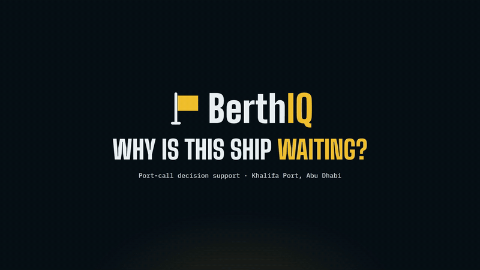
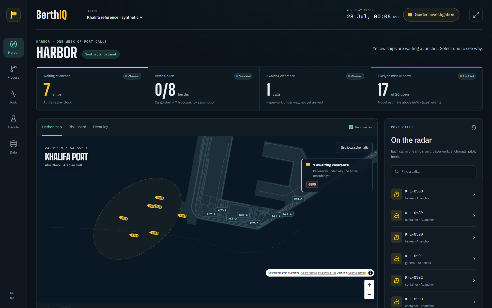
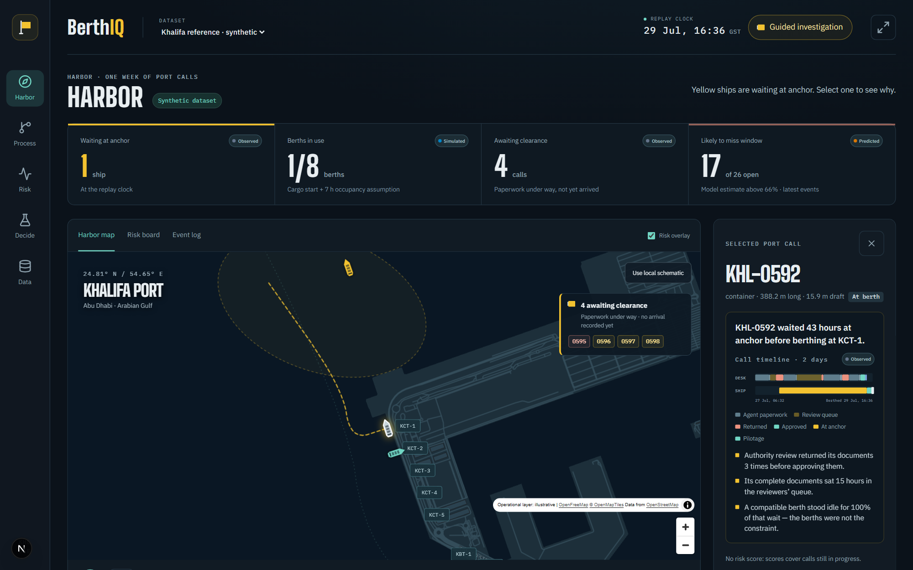
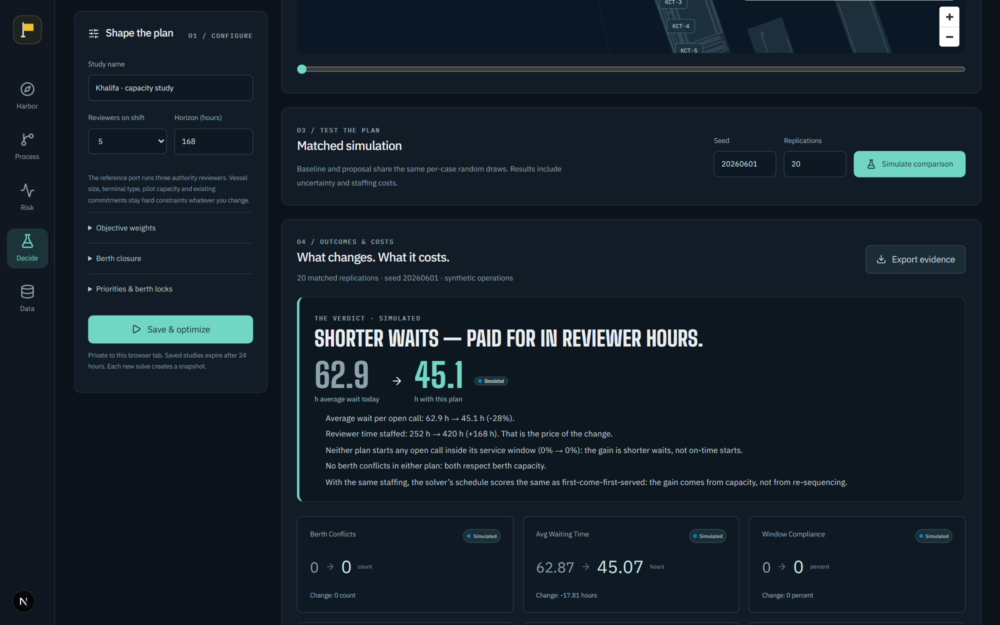
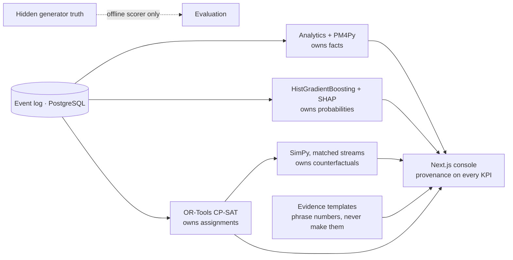

# BerthIQ

[](https://github.com/abdulaz06/berthiq/actions/workflows/ci.yml)

### Why is this ship waiting — and what should the port do about it?

Ships can ride at anchor for days while berths stand empty. BerthIQ reads a port’s
event log to find out why, flags which calls will be late next, and tests what the
port could change — with a constraint solver and a simulator — before anyone
changes it.



▶ **[Watch the 60-second film (1080p, 60 fps)](media/berthiq-showcase.mp4)** ·
Engineering story at `/case-study` ·
[Decision engine](DOCS/DECISION_ENGINE.md) ·
[Historical validation](DOCS/SIMULATOR_VALIDATION.md)

> **Synthetic operations on real port geography.** Vessel paths are illustrative;
> their timing comes from recorded events. No live AIS, no employer data, and no
> measured real-world savings — outcomes are simulated comparisons.

---

## The story in one ship

In BerthIQ’s reference week at Khalifa Port, container ship **KHL-0592** waited
**43 hours at anchor**. Its documents were sent back by authority review **three
times** and sat **15 hours** in the reviewers’ queue — while a berth that fit it stood
idle for **100%** of the wait. At one point seven ships were at anchor and all eight
berths were empty.

BerthIQ turns that into an investigation anyone can follow:

| | Move | What you see | Lineage |
|---|---|---|---|
| 01 | **Replay** | A week of port calls rebuilt from the event log: ships arrive, wait at anchor, take a pilot and berth on the recorded times. | observed |
| 02 | **Explain** | Each call’s two-lane timeline — paperwork above, the ship below — and process discovery over six months showing authority review as the largest controllable delay. | observed |
| 03 | **Forecast** | A gradient-boosting model scores each open call’s chance of missing its service window, with plain-language SHAP factors. 17 of 26 open calls are above 66%. | predicted |
| 04 | **Decide** | CP-SAT builds a plan that breaks no hard rule; 20 matched SimPy runs compare it with today’s plan under identical random delays. | optimized · simulated |

The guided investigation (`/console?story=1`) walks through all four in about three
minutes. It doesn’t play a video: it drives the real replay, process graph, risk
board, solver and simulator, and quotes their results back.





## The honest verdict

The reference experiment asks what five authority reviewers would do instead of three.

| Simulated outcome (20 matched replications) | Today | Five reviewers |
| --- | --- | --- |
| Average wait per open call | 62.9 h | **45.1 h** (−28%) |
| Reviewer time staffed — the cost | 252 h | **420 h** (+168 h) |
| Open calls started inside their window | 0% | 0% |
| Berth conflicts | 0 | 0 |

Two of those rows are the honest part. No open call is rescued — the cohort was
already late at the cutoff. And with equal staffing, the solver’s schedule ties
first-come-first-served: the gain is capacity, not clever sequencing. BerthIQ’s
verdict says both, in the product, in plain words.



## Every number has exactly one owner



- **Frontend:** Next.js 16, React 19, TypeScript, MapLibre GL, React Flow. A Q-flag
  identity (the signal flag a ship flies while awaiting clearance), Big Shoulders and
  IBM Plex. Every KPI renders a provenance badge; a CI lint enforces it.
- **Replay motion:** ships appear at their recorded arrival, hold a stable anchorage
  slot, are piloted in over the recorded interval to “Berthed, cargo start”, and leave
  after the disclosed occupancy assumption (`frontend/lib/motion.ts`). Calls with no
  recorded arrival are listed as awaiting clearance, not parked on the map.
- **Explanations:** `lib/journey.ts` derives each call’s wait (review queue, returned
  documents, idle compatible berths) from observed events; `lib/verdict.ts` phrases the
  simulator’s numbers with their cost. No language model anywhere in the decision path.
- **API:** FastAPI modular monolith, Pydantic contracts generating the TypeScript
  types, SQLAlchemy + Alembic. Optimization and simulation run in two bounded
  subprocess slots with hard deadlines; interrupted jobs fail cleanly after restart.
- **Data discipline:** features, schedules and simulations read only observed event
  prefixes. Hidden generator ground truth stays out of the application.

## Run locally

Install Node 24, Python 3.12, PostgreSQL 16+ and `just` (plus Git for Windows).
Create a local database and configure the untracked root `.env` as described in
[SETUP.md](DOCS/SETUP.md).

```sh
just setup
just doctor
just migrate
just seed
just dev
```

Open **http://localhost:3000** and press **Start the investigation**, or go straight to
`/console`. API docs: http://localhost:8000/docs. `just seed` only inserts missing demo
data; the committed model is ready to use, so training is not a setup step.

## Evidence and limits

| Measurement | Result | Meaning |
| --- | --- | --- |
| Held-out PR-AUC / AUROC | 0.8777 / 0.9154 | 1,121 chronologically held-out synthetic prefixes |
| Brier score | 0.1030 | Probability error on the same prefixes |
| Bottleneck found by discovery | Authority review | 3 reviewers, 888 reviews, mean 5.0 h (p90 19 h) to start |
| Historical backtest | 7 of 8 cutoffs forecast | Timing MAE 0.02–9.30 h; interval coverage inconsistent |

Exact values are in [REFERENCE_EVALUATION.json](DOCS/REFERENCE_EVALUATION.json) and
[SIMULATOR_VALIDATION.md](DOCS/SIMULATOR_VALIDATION.md). Simulation bands describe
variability under assumptions, **not calibrated arrival confidence**. Deterministic FIFO
comparisons use the candidate staffing; the simulated no-change baseline keeps the
original staffing.

## Verification

```sh
just test-backend
npm --prefix frontend run lint
npm --prefix frontend run typecheck
npm --prefix frontend run test
npm --prefix frontend run check:provenance
npm --prefix frontend run build
just golden
```

Backend fixtures require a disposable PostgreSQL database ending in `_test`;
`just test-backend` supplies isolation and refuses the development database. CI runs
all of the above, then provisions PostgreSQL for the real Playwright journey: the
guided investigation from harbor to verdict, replay continuity (no teleporting),
discovery → optimization → matched simulation → export, an infeasible constraint,
private uploads, tile failure and axe WCAG A/AA scans at 1920×1080 and 390×844.

## Showcase media

Everything in `media/` and `DOCS/media/` is generated from the running application.

| Output | Command |
| --- | --- |
| Landing snapshot (`lib/fixtures/landing_story.json`) | `BERTHIQ_SNAPSHOT_API=http://localhost:8000 npx vitest run scripts/story-snapshot.test.mjs` |
| Product stills (`public/images/step-*`, `DOCS/media/*`) | `node scripts/media/capture-stills.mjs` |
| Film, thumbnail, poster and GIF (`media/`) | `FFMPEG=/path/to/ffmpeg node scripts/media/record-showcase.mjs` |

Run them from `frontend/` against a production build on :3000 and the seeded API on
:8000. The film is captured frame by frame on a virtual clock (BeginFrame control), so
it is a genuine, constant 60 fps at 1920×1080 regardless of machine speed; solver and
simulator waits happen off camera. Caption numbers are read from committed evidence.
ffmpeg must include libx264.

## Hosting and licensing

**Prepared for persistent hosting; not deployed.** [DEPLOYMENT.md](DOCS/DEPLOYMENT.md)
covers build settings, HTTPS origins, secrets, release steps and acceptance at real URLs.
**Licensing is pending contributor approval:** PM4Py is AGPL-3.0 and the repository has
no project license yet. Public hosting waits for that decision.

## Contributors

Built by **Abdul and Shravani**. Their implementations, committed risk model and
contribution history are preserved; later work is recorded in milestone pull requests.
