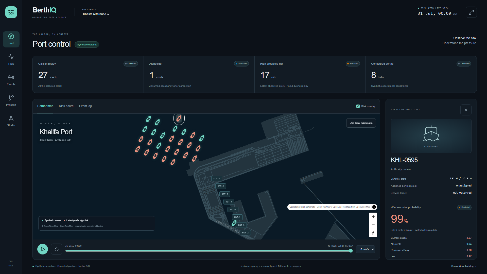
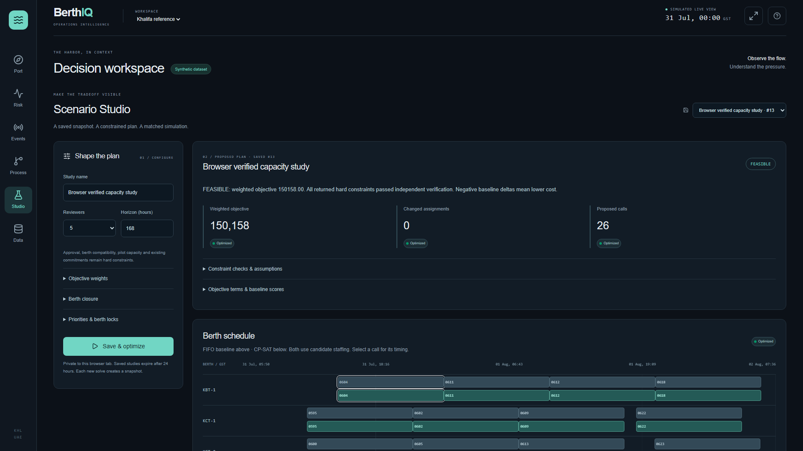
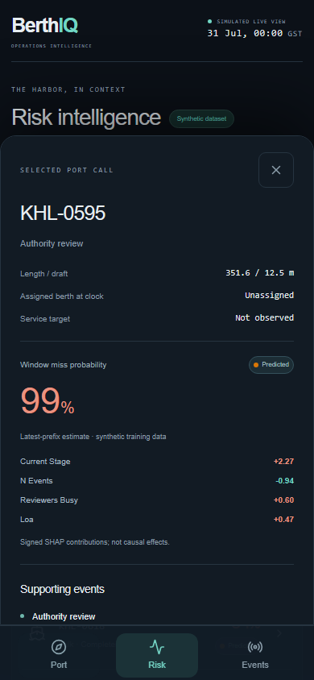
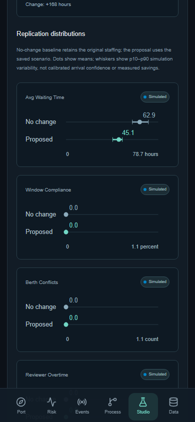
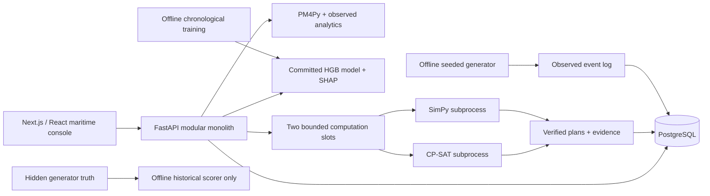

# BerthIQ

**Port operations intelligence, from event log to an inspectable decision.**

BerthIQ reconstructs port-call processes, identifies operational bottlenecks,
predicts window-miss risk, and compares constrained berth/reviewer plans through
matched simulation. A maritime control room makes the evidence explorable on
1920×1080 desktop and 390×844 mobile screens.

**Synthetic operational data. Simulated vessel movement. Approximate berth
coordinates. No live AIS, employer data, or measured real-world savings.**



[Setup](DOCS/SETUP.md) · [Deployment](DOCS/DEPLOYMENT.md) ·
[Decision engine](DOCS/DECISION_ENGINE.md) ·
[Historical validation](DOCS/SIMULATOR_VALIDATION.md) ·
[Sprint evidence](DOCS/CODEX_LAUNCH_SPRINT.md)

## Walk through the application

Start at `/` for the public introduction, `/console?tour=1` for a guided demo, or
`/case-study` for the engineering story.

1. **Select and validate.** Choose the built-in Khalifa reference or, when uploads
   are enabled, map a private CSV/XLSX event log into an immutable dataset version.
   Fatal errors and quality warnings remain distinct.
2. **Discover.** Explore the interactive process graph, trace variants, rework loops
   and observed bottlenecks. Authority review emerges from the reference log.
3. **Inspect risk.** Rank active calls using the committed gradient-boosting model
   and inspect SHAP contributions from each observed event prefix.
4. **Configure a scenario.** Adjust reviewer capacity, caps, priorities, berth locks,
   closures and objective weights. Inputs are snapshotted for reproducibility.
5. **Optimize.** CP-SAT assigns reviewers and berths under resource, dimension,
   terminal, shift and timing constraints. An independent checker verifies plans.
6. **Simulate and compare.** Matched random streams drive no-change and proposed
   schedules through SimPy queues. Inspect means, p10–p90 ranges, costs and berth
   Gantt charts. Toggle deterministic plans and the first simulated replication.
7. **Export evidence.** Download the scenario, input snapshot, solver evidence and
   simulation outcomes. Saved scenarios belong to the browser-tab session and expire.

The port map supports vessel/berth selection, risk overlay and a 48-hour event
playback. OpenFreeMap/OpenStreetMap geography has explicit attribution; a local
schematic keeps the console usable when tiles fail. Mobile has touch navigation,
a vessel detail sheet and responsive process, data and scenario workspaces.



<p>
  
  
</p>

## Architecture



- **Frontend:** Next.js 16, React 19, TypeScript, MapLibre GL, React Flow, a custom
  dark maritime design system and provenance badges at KPI displays.
- **API and persistence:** FastAPI/Pydantic contracts, SQLAlchemy, Alembic and
  PostgreSQL JSONB. Generated TypeScript types keep HTTP contracts aligned.
- **Decision responsibilities:** analytics owns facts, the model owns probabilities,
  CP-SAT owns assignments, SimPy owns counterfactuals, and templates phrase evidence.
  No runtime LLM and no training during requests.
- **Execution:** a persistent single API process supervises bounded child computations,
  kills over-time workers, stores durable results and marks interrupted jobs failed
  after restart. No Redis, Celery or Docker requirement for native development.
- **Data boundaries:** scheduling and prediction consume observed prefixes. Generator
  hidden labels stay out of application features, decisions and simulation inputs.

## Run locally

Install Node 24 LTS, Python 3.12, PostgreSQL 16+ and `just` (plus Git for Windows).
Create a local database and configure the untracked root `.env` as explained in
[SETUP.md](DOCS/SETUP.md). Keep existing configuration if you already have it.

```sh
just setup
just doctor
just migrate
just seed
just dev
```

Open **http://localhost:3000**; API docs: **http://localhost:8000/docs**.
The launcher handles paths with spaces on Windows. Ctrl+C stops its servers.
`just seed` inserts missing demo data without replacing existing scenarios.
The committed model is ready to use; training is not a setup step.

If Python was upgraded underneath a venv, `just doctor` detects incompatible
compiled extensions. Follow the documented backup/rename procedure; do not copy
Python 3.11 packages into Python 3.12 or delete a working environment unnecessarily.

## Evidence and limits

| Reference measurement | Recorded result | Meaning |
| --- | --- | --- |
| Held-out PR-AUC / AUROC | 0.8777 / 0.9154 | Committed model; 1,121 chronological test prefixes |
| Brier score | 0.1030 | Probability error on synthetic held-out prefixes |
| Simulated mean waiting | 62.874 → 45.067 hours | Five-reviewer reference experiment; 20 matched replications |
| Simulated compliance | 0 → 0% | No improvement in this deliberately difficult reference queue |
| Simulated berth conflicts | 0 → 0 | Both compared plans enforce berth capacity |
| Staffed reviewer time | 252 → 420 hours | Explicit additional staffing cost |

Exact values and scenario parameters are in
[REFERENCE_EVALUATION.json](DOCS/REFERENCE_EVALUATION.json). The deterministic FIFO
comparison uses candidate staffing; the stochastic no-change comparison retains
original staffing. They answer different questions and are labelled separately.

The [historical simulator backtest](DOCS/SIMULATOR_VALIDATION.md) evaluates eight
synthetic cutoffs: seven yield forecasts, one retains a historical berth that is
incompatible with current rules. Median-forecast timing MAE ranges from 0.02 to
9.30 hours, with inconsistent interval coverage. Simulation bands describe
variability under assumptions, **not calibrated arrival confidence**. External
validation and historical policy reconciliation remain open research work.

## Verification

```sh
just test-backend
npm --prefix frontend run lint
npm --prefix frontend run typecheck
npm --prefix frontend run test
npm --prefix frontend run check:provenance
npm --prefix frontend run build
just golden
```

Also run backend `ruff check app scripts tests` and `mypy app` inside the venv.
Backend fixtures require a disposable PostgreSQL database ending in `_test`;
`just test-backend` supplies isolation and refuses the development DB. Skipped DB
tests are not acceptance evidence.

GitHub Actions installs locked dependencies, audits npm/Python packages, runs the
backend and frontend checks, builds production assets, and provisions PostgreSQL
for the real Playwright journey. Browser tests cover private uploads/mappings,
fatal validation, discovery, risk, optimization, matched simulation, evidence
export/reload, an infeasible constraint, tile fallback and desktop/mobile use.
Screenshots are in `DOCS/media`; failing traces are CI artifacts.

## Public hosting status

**Prepared for persistent hosting; not deployed or verified at a public URL.**
[DEPLOYMENT.md](DOCS/DEPLOYMENT.md) documents build-time frontend settings, HTTPS
origins, secret storage, migration/seed release steps, production preflight,
health checks, database persistence and acceptance at real URLs. Uploads default
to disabled. The demo has quotas and per-tab tokens, not enterprise authentication.

**Licensing is pending contributor approval.** PM4Py is AGPL-3.0; the repository
currently has no project license. Public publication/hosting must wait for that
choice and the source/license disclosure requirements. No paid service or
commercial license has been purchased.

## Contributors

Originally built by **Abdul and Shravani**. Their implementations, committed risk
model and contribution history are preserved. Launch work is recorded in reviewed,
CI-verified milestone pull requests. Historical planning documents remain available
for context; [AGENTS.md](AGENTS.md) and the [launch tracker](DOCS/CODEX_LAUNCH_SPRINT.md)
record the current implementation and outstanding requirements.
